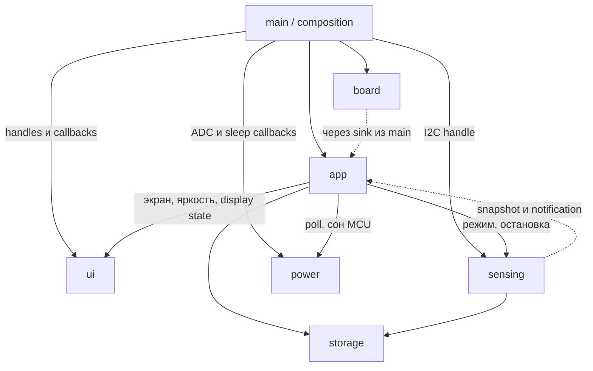

# Архитектура Nimbus v2

Этот документ задаёт целевое поведение и контракты новой реализации с нуля.
Текущее состояние кода и результаты проверок — в
[verification-log.md](verification-log.md). Код v1 остаётся в истории `master`
и в v2 не используется; изображения и шрифты генерируются из оригиналов
в `artwork/` ([assets.md](assets.md)).

## 1. Платформа и границы проекта

Одна прошивка C/C++ на ESP-IDF 5.5.3 под LILYGO T-Display, ESP32, профиль flash 4 МБ.
На подключённой плате обнаружен чип 16 МБ; текущая разметка использует первые 4 МБ,
факт и предупреждение загрузчика записаны в verification-log.
UI — LVGL 9.5.0; обработка BME680 — Bosch BSEC2 2.6.1.0. Независимый загрузчик
приложений, интерпретатор и поддержка неизвестных плат не входят в проект.

Внешний вид и пользовательские экраны сохраняются. Основные измерения: static IAQ,
температура и влажность. Давление в Па и сопротивление газа в Ом доступны только
в диагностическом логе; отдельного пользовательского экрана для них нет.

| Узел | Подключение |
| --- | --- |
| ST7789 135×240 | MOSI19, SCLK18, CS5, DC16, RST23, подсветка4; портрет, кнопки под экраном |
| MISO дисплея | `-1`, GPIO21 занят I2C |
| PREV / NEXT | GPIO0 / GPIO35, активный LOW; GPIO35 требует внешней подтяжки |
| BME680 | SDA21, SCL22, 3,3 В, адрес 0x76 или 0x77 |
| Батарейный ADC | GPIO34 / ADC1 channel6, ADC_EN14; поведение проверить на плате |
| Аккумулятор | 103030, 1150 мА·ч, 3,7 В, штатный разъём под экраном |

Назначения GPIO сохраняются. Основные электрические неизвестные перечислены
в [протоколе этапа 1](hardware-bringup.md).

## 2. Владельцы состояния и зависимостей

| Компонент | Владеет | Публичный контракт |
| --- | --- | --- |
| `main` | Создание, соединение и время жизни инфраструктуры | Composition root |
| `board` | Аппаратные ресурсы и их низкоуровневые операции | Handles, callbacks и результаты инициализации |
| `app` | Состояние устройства, экран, предпочтение яркости, политики и сроки | События и функции переходов с явным временем |
| `ui` | Все объекты LVGL, дисплей, его сон, фактическая подсветка и display PM lock | `ui_apply_model()`, `ui_set_display_state()` |
| `sensing` | BME680/BSEC, фаза датчика, расписание, восстановление и state blob | Запросы режима/остановки, последний snapshot |
| `power` | Оценка батареи и выполнение команды сна MCU | Синхронный `power_poll()`, подготовка и вход в сон |
| `storage` | Формат и сохранение настроек / blob | Чтение и запись с результатом ошибки |

Только `main` зависит от компонента `board`. Инициализация платы разделена на
минимальную часть GPIO/ввод/ADC и остальные ресурсы после стартового контроля
питания (раздел 11). Результат содержит отдельные статусы готовности;
`composition.c` передаёт ресурсы потребителям:

- `sensing`: заимствованный `i2c_master_bus_handle_t`; сервис сам пробует адреса
  и владеет созданным device handle. Владельцем самой шины остаётся `main`.
- `ui`: panel и panel-IO handles, callbacks PWM и передачи GPIO4 с контекстом.
- `power`: `read_battery_fn(ctx, out)` и callbacks подготовки/входа в сон.
  ADC unit/cali handles принадлежат аппаратному адаптеру и не попадают в модель.
- `board` распознаёт жесты кнопок через `espressif/button` и передаёт события
  с монотонной отметкой времени через sink из `main`; политика ввода — в `app` (раздел 6).

Callbacks используют типы контрактов потребителя; сигнатуры из `board.h` не
утекают в `sensing`, `ui` и `power`. Платформенные конфигурации с IDF handles
отделены от обычных C-заголовков моделей и политик.



Нижние слои не включают заголовки `app`. Настройки яркости хранятся в `storage`,
но актуальное предпочтение находится в `app`; только `ui` исполняет изменение PWM.
`power` не реализует управление дисплеем, LVGL или подсветкой. Его аппаратный
callback окончательного сна имеет отдельный аварийный контракт из раздела 4.

## 3. Структура проекта

Это границы компонентов, а не обещание конкретных будущих `.c` файлов:

```text
nimbus/
├── firmware/                     # проект ESP-IDF, свой .gitignore
│   ├── main/                     # app_main, composition, manifest
│   ├── components/
│   │   ├── app/      include/{app.h, app_events.h, app_state.h}
│   │   ├── board/    include/board.h
│   │   ├── sensing/  include/sensing.h
│   │   ├── power/    include/power.h
│   │   ├── storage/  include/storage.h
│   │   └── ui/       include/{ui.h, ui_model.h}
│   ├── assets/                   # .bin и .fnt, генерируются из artwork/
│   ├── third_party/              # BSEC2 и BME68x, git submodules
│   ├── dependencies.lock
│   ├── sdkconfig.defaults
│   └── partitions.csv
├── artwork/                      # оригиналы изображений; OTF только локально
├── docs/
└── tools/                        # локальный генератор ассетов, вне Git
```

Директории создаются вместе с реализацией. Используются новые API IDF:
`driver/i2c_master.h`, `esp_adc/adc_oneshot.h`, `adc_cali`, `esp_lcd`.
Legacy I2C driver и legacy ADC API не используются.

## 4. Контракт UI и сквозные сценарии

Один API владеет всеми переходами дисплея:
`ui_set_display_state(ui, ON | DIM | OFF, effective_brightness_pct)`.
`app` вычисляет режим и эффективную яркость; UI возвращает результат, а не
объявляет неудавшийся переход успешным. Повтор одинакового запроса идемпотентен.
Сохранённая пользовательская яркость при DIM/OFF не меняется.

**OFF:** запретить новые render/flush, остановить LVGL tick/timers под его lock,
дождаться завершения уже запущенного SPI DMA с таймаутом, погасить PWM, выполнить
display-off и `esp_lcd_panel_disp_sleep(panel, true)`, остановить LEDC с idle LOW
и через callback передать GPIO4 аппаратному адаптеру. Только после подтверждения
сна панели и отсутствия DMA освободить `ESP_PM_NO_LIGHT_SLEEP`.
Ожидание DMA не удерживает mutex, требуемый обработчику его завершения.

**ON/DIM из OFF:** сначала взять PM lock, через callback получить GPIO4 обратно
с гарантированным LOW и восстановить LEDC с duty=0, вывести панель из сна с задержками
драйвера, восстановить LVGL, отрисовать актуальную модель, дождаться первого flush
и применить яркость. До первого кадра подсветка остаётся нулевой.
При ошибке остаётся безопасное тёмное состояние и возвращается ошибка в `app`.
Если незавершённый DMA не позволяет заснуть, PM lock сохраняется до восстановления.

При ошибке OFF по таймауту простоя `app` остаётся ACTIVE с признаком ошибки дисплея,
не объявляет MONITORING и не разрешает light-sleep. UI сообщает достигнутое состояние;
частично погасший экран не считается ON. Повторы OFF — через 1 с, максимум три
повторные попытки; успех переводит в MONITORING, исчерпание — в headless FAULT.
Ввод может запросить восстановление ON. PM lock сохраняется, если DMA/панель
не подтверждены; дальнейшее завершение в FAULT ограничено разделом 11.
Неудавшийся ON/DIM повторяется по тому же правилу: через 1 с, не более трёх раз,
затем до следующего события кнопки.

В LVGL 9.5 / esp_lvgl_port 2.9.0 `lvgl_port_stop()` отключает tick и timers, но задача
порта продолжает цикл: `lv_timer_handler()` с выключенными таймерами возвращает 1,
и задача просыпается каждые два тика; без `lvgl_port_stop()` её ограничивает только
`task_max_sleep_ms` (500 мс), а tick-таймер срабатывает каждые 5 мс. Порт не форкается. На время OFF `ui` берёт
рекурсивный LVGL mutex в задаче, запросившей OFF, и держит его до выхода из OFF:
задача порта блокируется в `lvgl_port_lock(0)` без таймаута, а владение mutex
подтверждает, что render не идёт. Завершение DMA ждётся по флагу, который
снимает прерывание передачи без mutex. Поэтому `ui_set_display_state()` вызывается
из одной задачи (`app_task`); другая задача при OFF получает ESP_ERR_INVALID_STATE.
`ui_apply_model()` владельца при OFF только меняет объекты; `app` при OFF модель
не передаёт и отправляет её перед запросом ON. Произвольный `vTaskSuspend` задачи
порта запрещён.

Рисует только задача LVGL: стек вызывающих задач (main и app по 4 КиБ) рассчитан
не на рендер LVGL 9, `lv_refr_now()` из main переполнил его. Для первого кадра
и выхода из OFF `ui` инвалидирует экран, отпускает lock и ждёт
`LV_EVENT_REFR_READY` запрошенного обновления, затем завершения DMA.

`app_task` вызывает `ui_apply_model()` синхронно: внутри берётся ограниченный
по времени `lvgl_port_lock`, изменяются только отличающиеся поля, затем unlock.
При OFF можно обновить объекты/последнюю модель, но запускать отрисовку нельзя.
При timeout приложение оставляет модель dirty и повторяет передачу по явному
сроку. Отдельного буфера доставки с таймером опроса нет. LVGL render task остаётся
владельцем flush; app не получает `lv_obj_t*`. Timer callbacks lock повторно не берут.

Подтверждённое выключение координирует `app`: закрыть приём новых пользовательских
команд, показать состояние выключения, запросить остановку `sensing`, дождаться
ACK с request ID не более 3 с, сохранить настройки при доступном storage,
вызвать UI OFF и передать команду deep-sleep в `power`. Истечение ACK не отменяет
выключение: записать диагностику и продолжить без нового checkpoint. BSEC/deinit
из чужой задачи запрещён; поздний ACK не возобновляет работу. При отсутствии ACK
не начинать новые записи storage, конкурирующие с незавершённой записью sensing.
Для критического разряда используется тот же путь с приоритетом сна.

Общий срок завершения сервисов и UI — не более 5 с от подтверждения выключения;
операции внутри получают оставшийся бюджет. Затем проверяется отпускание кнопок
по разделу 9. Ошибка UI OFF не выдаётся за успех, но не отменяет окончательный сон.
Аварийный `prepare_terminal_sleep` аппаратного адаптера выполняет только GPIO:

1. Переводит GPIO4 на RTC mux, задаёт LOW и включает RTC hold; так сигнал LEDC
   физически отключается от подсветки. GPIO14 также выключается и удерживается LOW.
2. Подаёт аппаратный reset ST7789 на GPIO23: LOW не менее 10 мкс (проектно 1 мс),
   затем HIGH; выдерживает 120 мс и удерживает HIGH через `gpio_hold_en` вместе
   с `gpio_deep_sleep_hold_en`. GPIO23 не является RTC-пином.
3. Передаёт управление непосредственно `esp_deep_sleep_start()`.

Прерывать SPI DMA, обращаться к регистрам SPI, захватывать чужие mutex или ограждать
panel handle terminal-флагом не требуется. Цифровой домен выключается при входе
в deep-sleep. H/W reset возвращает ST7789V в Sleep In; обычный уже запущенный flush
содержит CASET/RASET/RAMWR, но не SLPOUT. После начала окончательного выключения app
не запрашивает ON/reinit; UI не выполняет самостоятельных reset/SLPOUT из flush.
Так аппаратный reset не конкурирует с новым включением панели. Ток панели после
reset сравнивается с обычным SLPIN на этапе 1. Возобновление работы после этого
callback запрещено; вызовов LVGL/BSEC/deinit из чужой задачи нет.
При прерванном сохранении допускается потеря последнего checkpoint; старый blob
не стирается. Вход в deep-sleep не возвращается, автоматического restart нет.

Обычный OFF возвращает токен передачи GPIO4 только после остановки LEDC.
`board` ставит RTC hold лишь после получения токена; обратная передача сначала
задаёт LOW, снимает hold и восстанавливает цифровой mux, затем разрешает UI PWM.
При загрузке GPIO4 изначально принадлежит board и остаётся LOW до проверки питания
(раздел 11). После deep-sleep board также восстанавливает HIGH на GPIO23 перед
снятием digital hold. Аварийный terminal callback обходит обычную передачу через UI.

## 5. Задачи, доставка данных и watchdog

- `app_task` — единственный изменяющий `app_state`. Ждёт task notification либо
  ближайший срок батареи, простоя, свежести или повтора команды.
- `sensing_task` — единственный владелец BME680/BSEC, ждёт `next_call` или команду.
- LVGL task обслуживает render только при разрешённом дисплее. Она закреплена
  на ядре прерывания SPI-шины дисплея: отрисовка с другого ядра зависала
  в `spi_device_acquire_bus` (ESP-IDF 5.5.3, журнал проверок).
- `power` — синхронная библиотека без своей задачи. `app` вызывает `power_poll()`
  по собственному сроку; callback ADC ограничен по времени.

Для телеметрии используются последние snapshot с generation/timestamp под mutex.
`sensing` записывает snapshot, отпускает mutex и будит `app` битом `xTaskNotify`.
Несколько обновлений объединяются. Результат синхронного `power_poll()` обрабатывается
в текущей итерации app без бессмысленного уведомления самого себя.

В очередь идут внешние пользовательские команды; распознанные жесты app обрабатывает
локально без повторного enqueue. События кнопок приходят из задачи esp_timer библиотеки
`espressif/button`; sink только копирует событие и будит app, без блокирующих вызовов.
После enqueue команды выставляется control-bit,
поэтому `app` ожидает одну notification, а не блокируется только на очереди.
ACK остановки имеет отдельный слот с request ID и бит; заполненная очередь ввода
его не блокирует. Ожидание читает/очищает биты атомарно; mutex телеметрии никогда
не удерживается при вызовах UI, BSEC или storage.

Начальная ёмкость очереди — 16 команд. Слоты не гарантируют бесконечную вместимость
команд: при отказе enqueue выставляется sticky overflow flag, выполняется явная
диагностика и отмена неоднозначного подтверждения. Ошибка не скрывается.

Task WDT: 10 с, timeout вызывает panic и попытку записи coredump. Задачи `app` и
`sensing` подписаны во время работы и сбрасывают WDT в контрольных точках.
В LP sensing остаётся подписанным между циклами: ожидание около 3 с вместе с
ограниченной работой укладывается в 10 с. Подписка снимается только перед штатным
долгим ожиданием (ULP, длительный backoff, app в мониторинге), если полный интервал
до следующего reset WDT не укладывается в бюджет. После пробуждения подписка
восстанавливается до работы. Блокирующие аппаратные операции имеют меньшие таймауты.
ULP-ожидание 300 с не сопровождается пробуждениями лишь ради watchdog. IDLE checks
сохраняются; потерянное измерение дополнительно выявляет deadline свежести в app.

## 6. Состояния приложения и навигация

`app_state` содержит режим (`STARTING`, `ACTIVE`, `MONITORING`, `SHUTTING_DOWN`,
`FAULT`), выбранный экран, параметры диалога, настройки, последние snapshot,
их достоверность и сроки. Enum фазы датчика принадлежит `sensing`; app копирует его.
Прогрев датчика и сон дисплея — независимые состояния.

Разделение ввода:

- `board` распознаёт жесты библиотекой `espressif/button` (версия закреплена
  в `firmware/components/board/idf_component.yml`). Опрос 10 мс × 5 отсчётов = debounce 50 мс.
  События: PRESSED, LONG (один раз за удержание), SHORT (отпускание без LONG, перед
  RELEASED), RELEASED. Callbacks выполняются в задаче esp_timer. Нажатие, удерживаемое
  при инициализации board, не выдаёт SHORT/LONG до отпускания: так потребляется
  нажатие, разбудившее устройство из deep-sleep.
- Режим power save библиотеки: при отпущенных кнопках её таймер остановлен, вооружён
  level-LOW interrupt и `gpio_wakeup_enable`; нажатие снимает wake этого пина и
  запускает опрос, повторное вооружение — после отпускания всех кнопок. От PRESSED
  до RELEASED board удерживает `ESP_PM_NO_LIGHT_SLEEP`. Операции сна повторно
  проверяют уровни непосредственно перед входом.
- `app` владеет политикой: таблица навигации, поглощение wake-нажатия из light-sleep
  мониторинга и сроки. Он получает уже распознанные жесты и не включает IDF/FreeRTOS/LVGL.
  До запуска app минимальный стартовый путь использует то же правило стабильного
  отпускания; исключение для застрявшей кнопки при окончательном сне — в разделе 9.
- Ограничение библиотеки: новое нажатие в пределах 50 мс после отпускания считается
  повтором, и LONG на нём не формируется. 50 мс — минимальное окно повтора.

Дребезг: 50 мс; long press: 1500 мс от подтверждённого нажатия, один раз за удержание.
Short формируется
только после отпускания, если long не был выдан. Wake-нажатие полностью потребляется
до отпускания и не вызывает навигацию/выключение.

Основной цикл: `IAQ → TEMP → HUM → IAQ`; PREV идёт в обратную сторону.
Яркость 5–100%, шаг 5%, начальное значение при отсутствии настройки — 60%.
В DIM эффективная яркость `min(user_brightness, 10%)`; например, 5% остаются 5%.
Видимость 5% и отсутствие мерцания проверяются на плате, до этого нижняя граница
предварительная; если её нужно поднять, диапазон и миграция настройки меняются явно.

| Экран / режим | Short PREV | Short NEXT | Long PREV | Long NEXT |
| --- | --- | --- | --- | --- |
| STARTING | Игнорировать | Игнорировать | Игнорировать | Игнорировать |
| IAQ | HUM | TEMP | Открыть выключение, выбран Yes | Открыть яркость |
| TEMP | IAQ | HUM | Открыть выключение, выбран Yes | Открыть яркость |
| HUM | TEMP | IAQ | Открыть выключение, выбран Yes | Открыть яркость |
| BRIGHTNESS | −5%, с ограничением | +5%, с ограничением | Игнорировать | Сохранить и вернуться |
| SHUTDOWN QUESTION | Если Yes выбран — подтвердить; иначе выбрать Yes | Если No выбран — отменить; иначе выбрать No | Игнорировать | Игнорировать |
| MONITORING | Разбудить, потребить нажатие | Разбудить, потребить нажатие | То же wake-нажатие, без long-команды | То же |
| Headless FAULT | Игнорировать | Игнорировать | Выключить без экранного подтверждения | Игнорировать |
| SHUTTING_DOWN | Игнорировать | Игнорировать | Игнорировать | Игнорировать |

Это сохраняет управление v1, включая исходный выбор Yes; отпускание открывшего
диалог long press не подтверждает выключение. Отмена/выход возвращает прежний
основной экран. Диалог автоматически отменяется через 15 с после открытия,
независимо от выбора; событие на самом deadline уже относится к основному экрану.
После 30 с бездействия — DIM, после 60 с — OFF/MONITORING только при успешном OFF.
При уходе в мониторинг незавершённый диалог отменяется, яркость сохраняется;
wake возвращает основной экран. Действие из DIM одновременно восстанавливает ON
и выполняется. После мониторинга первое нажатие только будит экран.

Подключение USB (переход источника BATTERY → EXTERNAL; USB, найденный при загрузке,
не объявляется) показывает экран с молнией на 3 с без изменения навигации;
жест SHORT/LONG только закрывает его. Уведомление не перекрывает диалог
выключения. Экрана «Заряжено» нет, пока окончание зарядки не подтверждено.
Приоритет критической ошибки выше уведомления.

## 7. Измерения и BSEC

Контракты фаз, условия показа IAQ, config blobs, политика сохранения и подключения
библиотеки определены в [bsec.md](bsec.md). IAQ и static IAQ хранятся отдельно;
показать 0 вместо недостоверного результата запрещено. Температура и влажность
имеют собственные validity/timestamp и могут быть доступны во время прогрева IAQ.

Свежесть определяется фактическим новым результатом, а не возвратом кэша.
Начальные пороги stale: LP 10 с, ULP 660 с от последнего нового значения.
После запроса смены режима порог не расширяется до подтверждения sensing.
Ошибка чтения отмечает проблему, последнее число сохраняется только с признаком
устаревания. Давление в BSEC передаётся в Па.

Ошибки первичной/повторной инициализации запускают retry с backoff 1, 2, 5, 10,
затем 30 с. Контроль ввода/батареи продолжает работать. Неудача reinit не делает
сервис навсегда неактивным. Точное расписание измерений принадлежит `next_call` BSEC.

## 8. Питание и процент батареи

Источник, зарядка, наличие батареи и достоверность SOC — независимые поля.
Основной сценарий на штатной плате: источник UNKNOWN или предполагаемое USB,
зарядка UNKNOWN; доступность CHRG на GPIO не предполагается.
Переход к подтверждённым состояниям разрешён только по аппаратному измерению
или проверенному сигналу, а не по росту напряжения и выдержке времени.

| Достоверные данные | UI |
| --- | --- |
| Работа от батареи, SOC доступен | Значок батареи и процент |
| Зарядка подтверждена, SOC доступен | Индикатор зарядки и процент |
| Зарядка подтверждена, SOC неизвестен | Индикатор и `--%` |
| Подтверждено только внешнее питание | Значок питания; без утверждения о зарядке |
| Только предполагаемое USB | Циклическая анимация уровней батареи с молнией, без процента (решение пользователя: она идёт и при полной батарее или без неё) |
| Завершение зарядки подтверждено | «Заряжено» |

ADC_EN включается только для замера, выключается в том числе после ошибки ADC.
Это контракт управления GPIO14: LOW по завершении. Первый замер при USB дал
одинаковые медианы при LOW/HIGH; отключение самой измерительной цепи в этом
подключении не подтверждено. Электрический эффект проверяется отдельно в A2/A3.
Оценка: калиброванный ADC → серия отсчётов → фильтр → профиль конкретной батареи
→ SOC; сглаживание UI — отдельный последний шаг. Недостоверный ADC не равен 0%.
Критический разряд определяется напряжением с подтверждением и гистерезисом.
Пороги и поведение при USB выбираются после начальных измерений этапа 1;
фиксированная компенсация «−100 мВ при зарядке» не считается универсальным решением.

Батарея опрашивается раз в 2 с при активном экране, раз в 60 с в мониторинге;
при подтверждённом приближении к порогу — чаще. Это исходные сроки для измерения,
а не подтверждённая защита. Интервал и пороги пересматриваются по результатам.
В мониторинге некритичный замер совмещается с ближайшим уведомлением sensing:
после 55 с можно выполнить его досрочно, предельный срок остаётся 60 с.
Если уведомления нет (ошибка датчика, ULP 300 с), app просыпается по этому сроку.
Критические проверки не откладываются ради объединения пробуждений.

## 9. Light-sleep и deep-sleep

LEDC использует APB; при ON и DIM UI удерживает `ESP_PM_NO_LIGHT_SLEEP`.
DFS допустим с корректным тактированием PWM/SPI; сейчас `main` задаёт
`esp_pm_configure` с min = max = частоте CPU по умолчанию и разрешённым light-sleep,
включение DFS — отдельное решение после измерения тока. Light-sleep разрешается только
после полного UI OFF. Работа LEDC от RC_FAST во сне не входит в базовый вариант.
Wi-Fi/Bluetooth не запускаются. Базовое измерение — LP, ULP добавляется на этапе 5.

| Режим | Пробуждение / удержание |
| --- | --- |
| Light-sleep, экран OFF | GPIO0 и GPIO35: `GPIO_INTR_LOW_LEVEL` через `gpio_wakeup_enable` и `esp_sleep_enable_gpio_wakeup`; вооружает `espressif/button` в power save |
| Нажатая кнопка | Библиотека снимает level wake пина; board держит `ESP_PM_NO_LIGHT_SLEEP` до RELEASED, wake вооружается снова после отпускания всех кнопок |
| Deep-sleep PREV | `esp_sleep_enable_ext0_wakeup(GPIO_NUM_0, 0)` |
| Deep-sleep NEXT | `esp_sleep_enable_ext1_wakeup_io(1ULL << GPIO_NUM_35, ESP_EXT1_WAKEUP_ALL_LOW)` |

EXT0 и EXT1 совместимы на целевом ESP32; маска EXT1 содержит только GPIO35.
`ALL_LOW` с двумя активными LOW-кнопками потребовал бы одновременного нажатия.
EXT0 оставляет RTC_PERIPH включённым, что учитывается в токе deep-sleep.
ULP как режим BSEC не означает использование ULP-сопроцессора ESP32.

Перед deep-sleep обе кнопки должны быть отпущены стабильно 50 мс; ожидание
ограничено 3 с. Для обычного запроса сна застрявшая кнопка откладывает сон с
диагностикой. Для окончательного выключения, критического разряда и отказа загрузки
после 3 с отключается deep-sleep wake удерживаемой кнопки, затем устройство засыпает:
оставшаяся отпущенная кнопка может будить. Если зажаты обе — сон без кнопочного wake
до внешнего reset/питания. Автоматический timer-wake в этих случаях не включается,
USB сам по себе не считается доступным источником wake. Это исключение диагностируется;
следующее штатное включение заново вооружает оба источника. GPIO0 — strapping pin:
запрещён автоматический restart,
пока PREV удерживается; внешний reset/power-on с ним может выбрать download mode.
После wake нажатие подавляется до отпускания, RTC pins возвращаются в GPIO.

Перед сном панель получает SLPIN, LEDC останавливается, GPIO4 и GPIO14 фиксируются
в LOW; передача GPIO4 выполняется по контракту раздела 4, ADC_EN не может остаться
активным после измерения. Базовый вариант для этих RTC-capable выводов — RTC output
и `rtc_gpio_hold_en`.
После wake сначала задаются известные безопасные уровни, затем корректно снимается
hold и возвращается цифровая функция; проверяется отсутствие вспышки подсветки.
Для цифрового варианта недостаточно одного `gpio_hold_en`: нужен также
`gpio_deep_sleep_hold_en`. Глобальный force-hold всех пинов не используется.
Настройки подтяжек кнопок, SPI и I2C проверяются по схеме и реальному току.

Измерение тока сна всей платы с удержанием GPIO и проверка wake выполняются
до оптимизаций. Расчёт 1150 мА·ч / средний ток — оценка; питание USB и ток только
ESP32 не подменяют измерение тока аккумулятора.

## 10. Память, ресурсы и хранение

Базовый вариант остаётся SPIFFS `/spiffs` и runtime `.fnt`; см.
[assets.md](assets.md). Замена на LittleFS или EMBED_FILES — отдельное решение
по измерениям этапа 2. LittleFS потребует явной зависимости и своей конфигурации;
просто сменить subtype раздела недостаточно.

Пять `.fnt` занимают около 80 КиБ файлов, а `lv_binfont_create` размещает данные в heap;
фактическое выделение измеряется отдельно. Фиксируются free/minimum/largest block
внутренней и DMA-памяти до/после загрузки шрифтов, draw buffers и создания экранов.
Проверяется многократная навигация. Кэш всех изображений в RAM не предполагается:
кэш LVGL ограничен 48 КиБ, этого хватает на картинки самой тяжёлой страницы вместе
с кадрами моргания. Без кэша LVGL 9 заново открывает и читает файл для каждой
полосы отрисовки.

Встраивание `.bin` может исключить файловые чтения изображений и хранить пиксели
во flash. Оно не является автоматически zero-copy для SPI DMA: проверяются
формат/выравнивание LVGL 9, заголовок, порядок байтов RGB565 и требования DMA к буферу.
Числа ширины/высоты не извлекаются предположением о произвольном 4-байтовом файле.

Настройки версионируются и проверяются по диапазонам. Яркость сохраняется через
2 с после последнего изменения, при выходе из настройки и штатном выключении;
не на каждое нажатие. Ошибка ключа не стирает весь NVS. SPIFFS автоматически
не форматируется. Память и ожидания имеют явные границы.

## 11. Загрузка, отказы и диагностика

### Старт без вспышки и просадки питания

`main` сначала читает reset/wake reason и запись аварийных стартов, затем поднимает
только безопасные GPIO, ввод, ADC и синхронный `power`. GPIO4 остаётся LOW; panel init,
LEDC, LVGL, файловые ресурсы и sensing ещё не запускаются. Первый `power_poll()`
с ограниченным временем выполняется **до включения панели и подсветки при любом
старте**, особенно после BROWNOUT и deep-sleep. Если ADC требует повторения для
подтверждения, весь ограниченный цикл выполняется с тёмным экраном.

- Достоверное напряжение ниже стартового порога: не создавать UI/sensing, сразу
  перейти к окончательному deep-sleep после правил отпускания кнопок. Световой
  индикатор при этом не включается. Порог возврата выше порога выключения;
  оба определяются по измерениям, включая просадку под нагрузкой.
- После BROWNOUT разрешение запуска требует достоверного напряжения выше порога
  возврата. UNKNOWN или недостаточное напряжение означает тёмный deep-sleep;
  предполагаемое USB не обходит проверку. BROWNOUT не приписывается программному crash.
- На другом старте ADC UNKNOWN сам по себе не означает разряд: допускается
  ограниченный запуск с недоступным SOC и диагностикой; повторный BROWNOUT уже
  направляет в предыдущую ветку. Без достоверных измерений защита от разряда
  не объявляется работающей.

Только после разрешения питания создаются остальные ресурсы и `app` в STARTING.
Первый кадр основной страницы строится сразу, с INITIALIZING/ожиданием датчика;
прогрев BSEC не задерживает интерфейс. Успешные `ui_apply_model()` и ON с завершённым
первым flush переводят STARTING в ACTIVE. От начала UI init отводится максимум 5 с;
ошибка или deadline переводит в headless FAULT. Отдельной обязательной заставки нет.
STARTING/FAULT не маскируют самостоятельные статусы достоверности измерений.

### Ограничение аварийных перезапусков

Запись `RTC_NOINIT_ATTR` принадлежит стартовому коду `main`: magic, версия, checksum,
насыщающийся crash_count, safe_mode latch и последний этап запуска. Она проверяется
до создания сервисов. Причины `ESP_RST_PANIC`, `ESP_RST_TASK_WDT`, `ESP_RST_INT_WDT`
и `ESP_RST_WDT` увеличивают счётчик. После третьего такого сброса включается
безопасный режим: минимальные GPIO/ADC/ввод/UART, без sensing, LVGL и загрузки ассетов,
Экран не требует LVGL: после разрешения стартовой проверки питания board однократно
показывает три вспышки подсветки через GPIO4, 100 мс ON / 200 мс OFF, затем LOW.
UART сообщает SAFE MODE, причину и способ выхода. При низком/неподтверждённом питании
индикация не включается; после BROWNOUT сохраняется более строгая ветка выше.
Он использует headless FAULT и путь сна ниже, не перезапускает сервисы.
Нельзя надёжно определить виновника только по reset reason; поэтому автоматически
отключаются все необязательные сервисы, а этап старта служит диагностикой.

Счётчик сбрасывает `app` через callback в `main` после 5 минут непрерывной штатной
работы без FAULT, с обслуживаемым вводом/питанием и без аварийного сброса.
STARTING и безопасный режим не считаются такой работой; отсутствие BME680 само
по себе не мешает стабильности приложения. Deep-sleep и программный reset до
этого срока не обнуляют crash_count/latch. Валидный latch сохраняется между
пробуждениями: автоматического повторного запуска неисправного сервиса нет.
POWERON или невалидная RTC-запись начинают новую серию. Штатный способ ручного выхода —
отпустить PREV/NEXT и нажать отдельную RST/EN, затем повторить запуск после устранения
причины. При `ESP_RST_POWERON` стартовый код явно очищает latch независимо от того,
сохранилась ли RTC_NOINIT: на потерю содержимого памяти не полагаемся. Реальная
кнопка RST и возвращаемая ею причина сброса проверяются в этапе 1; до проверки
этот способ помечен как аппаратно неподтверждённый. USB-переподключение при подключённой
батарее не считается reset. Резервный способ — полный съём питания.
RTC_NOINIT не заменяет постоянный журнал: при потере питания,
сбросе RTC-домена или повреждении памяти запись может пропасть. Ошибки ROM/bootloader
и brownout до исполнения стартового кода этим программным механизмом не устраняются.

| Отказ | Поведение |
| --- | --- |
| Экран / panel / LVGL | UI недоступен, подсветка LOW; `FAULT`, UART-диагностика и доступный контроль батареи, без restart loop |
| Создание I2C bus | Sensing недоступен до следующей загрузки; диагностика, без пересоздания шины/handles на ходу |
| BME680/BSEC | ERROR/retry в sensing; UI, кнопки и батарея работают |
| ADC/cali | Питание UNKNOWN, SOC скрыт; ошибка не считается разрядом |
| Отдельные настройки NVS | Значения по умолчанию и диагностика, без erase |
| Файловые ресурсы | Доступный встроенный текст/простые фигуры и сообщение об ошибке, без format |
| Не созданы app/task/основная очередь | Main выполняет минимальный путь окончательного сна без app: тёмный дисплей, UART, ограниченное ожидание отпускания кнопок |

Графический UI обязателен для нормального ACTIVE. В headless FAULT команды,
требующие видимого подтверждения, не исполняются вслепую; отдельный long PREV
означает немедленный запрос окончательного сна без диалога. Нажатие, которым
устройство разбудили, сначала потребляется до отпускания. Через 120 с от входа
в headless FAULT — автоматическое окончательное выключение независимо от ввода;
критический разряд выключает раньше. Это относится и к безопасному режиму.
Ошибка UI не должна оставить активный PWM или запретить контроль батареи;
при недоступном обычном OFF действует terminal-контракт раздела 4.
Повторы адресов 0x76/0x77 и BSEC остаются внутри sensing на созданной шине.
Её время жизни — вся загрузка, автоматического restart ради I2C нет.

`coredump` занимает 64 КиБ после storage. Включены flash, ELF, CRC32, отдельный
стек 2048 байт, лимит 16 задач; полный DRAM capture выключен. Лимит учитывает
системные IDLE0/1, ipc0/1, esp_timer, FreeRTOS timer и будущие app/sensing/LVGL/ввод.
16 — предел числа захватываемых задач, а не гарантия размера дампа.
После появления задач составляется бюджет: сумма выделенных стеков и TCB всех
живых задач, ELF headers/notes/регистры, checksum и отдельные захватываемые области.
Резерв не менее 8 КиБ на метаданные до точного расчёта; сумма стеков/TCB должна
укладываться в оставшиеся 56 КиБ, затем сверяется реальный ELF dump.
Если не укладывается, до выпуска увеличивается раздел или обоснованно пересматриваются
стеки; уменьшение числа захватываемых задач не считается решением.
Сейчас полных сервисов нет: вместимость их будущего дампа в 64 КиБ не подтверждена.
Не применяется упрощённая формула binary dump как точная оценка ELF. Наличие раздела
не гарантирует сохранение любого fault: brownout/полная потеря питания могут
не оставить дамп. Эталонный ELF и map сохраняются для каждого аппаратного запуска.

Чтение: `idf.py -C firmware -p COM3 coredump-info` или `coredump-debug` с соответствующим ELF.
Контролируемая паника и чтение дампа входят в аппаратную диагностику этапа 1;
в продуктовой точке входа намеренного panic нет.

## 12. Проверки и этапы

Переходы, навигация, расчёт батареи и политики не включают ESP-IDF, FreeRTOS
или LVGL. `ui_model.h` не включает `lvgl.h`. Аппаратные сценарии выполняются
на устройстве с регистрацией реальных результатов.

1. **Board:** сначала ADC при USB с батареей / без неё и ток deep-sleep с pin hold;
   затем стартовый контроль питания, экран, ввод, I2C, оба wake и coredump. Протокол —
   [hardware-bringup.md](hardware-bringup.md). Результаты определяют разделы 8–9.
2. **App/UI:** таблица навигации, демонстрационная модель, display state machine,
   ожидание LVGL при OFF, передача GPIO4, политика ввода в app,
   безопасный режим после panic/WDT, расход heap и отсутствие утечек.
3. **Sensing:** LP и проверенный blob, фазы/валидность, retry, state persistence.
4. **Power/settings:** модель батареи на измеренных данных, сохранение яркости,
   завершение сервисов, сон и wake.
5. **ULP:** подходящий blob и отдельная проверка state compatibility и переключения;
   измерение среднего тока и задержки реакции перед включением профиля.

Готовность функции: сборка без новых предупреждений, boot без aborts/asserts,
изменённый путь выполнен на плате. Логи и результаты идут в verification-log,
а не в архитектуру. Неизмеренные значения остаются неизвестными.

## Источники

- [ESP-IDF 5.5.3: sleep modes](https://docs.espressif.com/projects/esp-idf/en/v5.5.3/esp32/api-reference/system/sleep_modes.html).
- [GPIO / hold](https://docs.espressif.com/projects/esp-idf/en/v5.5.3/esp32/api-reference/peripherals/gpio.html).
- [Core dump](https://docs.espressif.com/projects/esp-idf/en/v5.5.3/esp32/api-guides/core_dump.html).
- [esp_lvgl_port: LVGL 9 implementation](https://github.com/espressif/esp-bsp/blob/master/components/esp_lvgl_port/src/lvgl9/esp_lvgl_port.c).
- [ST7789V datasheet](https://files.seeedstudio.com/wiki/Grove-1.2inch-ips-display/ST7789V_SPEC_V1.2.pdf): reset timing §7.4.5 и Sleep In после H/W reset §9.1.11.
- Точные локальные Kconfig/headers и реализация SDK 5.5.3 проверяются вместе
  с закреплёнными зависимостями, а не по API другой модели ESP32.
