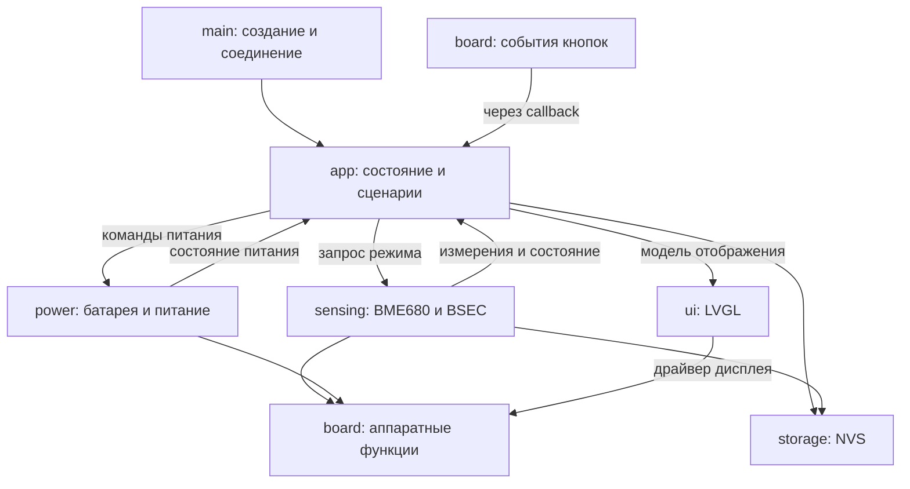

# Архитектура Nimbus v2

Статус: проект новой реализации; программные компоненты, описанные ниже, ещё не
реализованы. Ветка разработки: `rewrite/nimbus-v2`.

## 1. Область проекта

Nimbus — автономный монитор качества воздуха на текущей LILYGO T-Display с BME680.
Собственный код приложения проектируется заново, а не дорабатывается поверх
существующего `sensor_runtime`. Библиотеки Bosch и графические ресурсы могут
использоваться как внешние зависимости и данные.

Принятые решения:

- Одна прошивка ESP-IDF на C/C++ под ESP32.
- LVGL 8.4.0 для интерфейса, Bosch BSEC2 2.6.1.0 для обработки IAQ.
- Отдельные компоненты с явными интерфейсами и владельцами состояния.
- Новая реализация не предусматривает интерпретатор, загрузку приложений,
  отдельную системную прошивку или универсальный слой поддержки неизвестных плат.
- Возможная замена платы потребует адаптации аппаратных компонентов и интерфейса
  с пересборкой прошивки.

Основные функции: IAQ, температура, влажность, навигация двумя кнопками, настройка
яркости, индикация питания, фоновый мониторинг и выключение в глубокий сон.
Давление и сопротивление газа доступны для диагностики.

## 2. Текущее оборудование

| Узел | Подключение / параметры |
| --- | --- |
| Плата | LILYGO T-Display, ESP32, flash 4 МБ |
| Экран | ST7789, 135×240, SPI |
| SPI экрана | MOSI GPIO19, SCLK GPIO18, CS GPIO5, DC GPIO16, RST GPIO23 |
| MISO экрана | `-1`: GPIO21 используется как SDA датчика |
| Подсветка | GPIO4, PWM |
| Кнопки | PREV GPIO0, NEXT GPIO35 |
| BME680 | I2C, SDA GPIO21, SCL GPIO22, питание 3,3 В |
| Адрес датчика | Проверять 0x76 и 0x77 |
| Батарейный ADC | GPIO34, управление ADC_EN GPIO14; проверить на ревизии платы |
| Аккумулятор | 103030, 1150 мА·ч, номинально 3,7 В, 30×30×10 мм |
| Подключение аккумулятора | Штатный разъём платы под экраном, подтверждено пользователем |

Назначения пинов сохраняются. Номинальная энергия аккумулятора — около 4,26 Вт·ч.
Характеристика разряда, фактическая доступная ёмкость, ревизия платы и доступность
сигналов зарядного контроллера пока не подтверждены измерениями.

## 3. Компоненты и направления зависимостей

| Компонент | Ответственность | Граница |
| --- | --- | --- |
| `main` | Создание компонентов, порядок запуска, соединение callbacks | Не содержит сценариев работы устройства |
| `app` | Состояние устройства, события, навигация, политики режимов | Не обращается к GPIO, I2C, объектам LVGL или ключам NVS |
| `board` | Пины, аппаратная инициализация, ST7789, кнопки, PWM, ADC, сон | Не выбирает экраны и пользовательские сценарии |
| `sensing` | BME680, BSEC, расписание, состояние измерений, восстановление | Не вызывает UI и не выключает устройство |
| `power` | Оценка заряда, состояние питания, выполнение команд питания | Не содержит навигации и не рисует экраны |
| `storage` | Настройки и состояние BSEC в NVS | Не принимает решения о режимах устройства |
| `ui` | Модель отображения, экраны и ресурсы LVGL | Не опрашивает датчик, ADC и NVS |



Стрелки событий на диаграмме обозначают поток данных, а не обратную зависимость
сборки. `sensing`, `power` и `board` принимают callback с контекстом; конкретное
соединение с `app_post_event()` находится в `main/composition.c`.

`app` использует публичные API сервисов и UI. Низлежащие компоненты не включают
заголовки `app`. Публичные структуры приложения и модели UI не содержат
`lv_obj_t*`, дескрипторы ADC, I2C или NVS. FreeRTOS допустим в обвязке задачи
приложения; переходы состояния и политики выделяются в функции обычного C.

## 4. Целевая структура

Дерево описывает будущие файлы. У каждого компонента есть `CMakeLists.txt`;
повторяющиеся файлы сборки ниже опущены.

```text
nimbus/
├── main/
│   ├── app_main.c
│   ├── composition.c
│   ├── composition.h
│   ├── idf_component.yml
│   └── CMakeLists.txt
├── components/
│   ├── app/
│   │   ├── include/{app.h,app_events.h,app_state.h}
│   │   └── src/{app.c,app_task.c,navigation.c,policies.c,presentation.c}
│   ├── board/
│   │   ├── include/board.h
│   │   └── src/
│   │       ├── board.c
│   │       ├── pins.h
│   │       ├── display.c
│   │       ├── backlight.c
│   │       ├── buttons.c
│   │       ├── battery_adc.c
│   │       ├── i2c.c
│   │       └── sleep.c
│   ├── sensing/
│   │   ├── include/sensing.h
│   │   └── src/{sensing.c,sensing_task.c,bme680.c,bme680_bus.c,bsec.c,recovery.c}
│   ├── power/
│   │   ├── include/power.h
│   │   └── src/{power.c,battery.c}
│   ├── storage/
│   │   ├── include/storage.h
│   │   └── src/{settings.c,calibration.c}
│   └── ui/
│       ├── include/{ui.h,ui_model.h}
│       └── src/
│           ├── ui.c
│           ├── ui_update.c
│           ├── screens/{startup.c,air_quality.c,temperature.c,humidity.c,
│           │            brightness.c,shutdown.c}
│           ├── widgets/{status_bar.c,measurement.c}
│           └── resources/{images.c,fonts.c}
├── third_party/{bme68x/,bsec2/}
├── assets/{fonts/,img/}
├── tests/{app/,battery/}
├── docs/architecture.md
├── CMakeLists.txt
├── dependencies.lock
├── sdkconfig.defaults
├── partitions.csv
└── README.md
```

Запись `{a,b}` — сокращение нескольких отдельных файлов или каталогов.
При переносе внешних библиотек обновляются CMake и пути submodule с сохранением
лицензий и закреплённых ревизий. Активы сохраняют размещение SPIFFS `/spiffs`;
пути LVGL имеют вид `S:/spiffs/...`. Шрифты загружаются из `.fnt`.

## 5. Состояние приложения

Единственный владелец изменяемого `app_state` — задача приложения. Оно включает:

- режим: `STARTING`, `ACTIVE`, `MONITORING`, `SHUTTING_DOWN`;
- выбранный экран и состояние диалога выключения;
- состояние датчика: `INITIALIZING`, `WARMUP`, `CALIBRATING`, `READY`, `ERROR`;
- последнее измерение, его достоверность, монотонное время получения и актуальность;
- признаки BSEC: accuracy, stabilization, run-in;
- напряжение батареи, оценку процента и её достоверность;
- отдельно источник питания и состояние зарядки;
- яркость, время последнего действия пользователя и выбранный профиль измерений.

Прогрев датчика не является отдельным режимом питания: экран может быть погашен,
пока датчик продолжает необходимое ему расписание. Ошибка датчика тоже не должна
останавливать кнопки, интерфейс и контроль батареи.

Переходы получают событие и текущее монотонное время. Внутренние функции переходов
и навигации проверяются без платы; `app_task.c` исполняет решения через сервисы.
Отдельная универсальная система команд или отдельный компонент runtime не нужны.

## 6. Задачи и обмен данными

1. **Задача приложения** ожидает события в ограниченной очереди либо ближайший
   срок проверки батареи, простоя или актуальности данных. Периодический опрос
   каждые 100 мс для всех функций не используется.
2. **Задача измерений** единолично владеет экземпляром BME680/BSEC: выполняет
   инициализацию, чтение, смену режима, восстановление и сохранение состояния.
3. **Задача LVGL** применяет последнюю модель отображения и обслуживает дисплей.

Callbacks кнопок только передают события; удержание и отпускание имеют явную
семантику. Полярность определяется схемой платы, а не состоянием кнопки при старте.
Нажатие, которым устройство разбудили, не превращается в команду выключения.

При переполнении очереди ведётся счётчик ошибок. Телеметрию можно объединять до
последнего значения; команды пользователя и подтверждение остановки сервисов
не должны молча теряться. Конкретные размеры очередей и стека выбираются по
измерениям, без неподтверждённых гарантий задержки.

`ui_submit_model()` копирует модель в защищённый буфер. Объекты LVGL изменяются
внутри UI. Инициализация и создание таймеров вне задачи LVGL выполняются под
`lvgl_port_lock`; callbacks таймеров уже находятся под блокировкой и повторно
её не захватывают. Удалённые объекты не остаются доступными через старые указатели.

При выключении приложение запрашивает остановку `sensing` и ожидает результат
с ограниченным таймаутом. Деинициализация BSEC из другой задачи параллельно чтению
не допускается. После сохранения и остановки выполняется команда глубокого сна.

## 7. Измерения и восстановление

- Все значения имеют фиксированные единицы: °C, %RH, Па, Ом.
  `BSEC_INPUT_PRESSURE` получает Па без преобразования в гПа.
- IAQ и static IAQ сохраняются отдельно. По умолчанию на экране показываем
  **static IAQ** для стационарного монитора; это должно быть отражено в описании
  интерфейса. Диагностический лог содержит оба значения.
- До достоверного IAQ показывается прогрев, а не число 0 с хорошим статусом.
- Время измерения обновляется только при фактическом новом результате датчика,
  а не при возврате закэшированного значения библиотекой.
- Порог устаревания зависит от профиля LP/ULP. Ошибка чтения сохраняет последнее
  значение как историческое, но не делает его актуальным.
- Первичная ошибка инициализации и неудачная повторная инициализация переводят
  сервис в ограниченные по частоте повторные попытки. Ранний выход из-за
  `not initialized` не должен навсегда выключать восстановление.
- Расписание следует `next_call` BSEC. LP/ULP переключаются через поддерживаемый
  API с подходящей конфигурацией, а не увеличением произвольной задержки задачи.

## 8. Батарея и зарядка

Штатная зарядная схема работает аппаратно. Прошивка отвечает за наблюдение,
индикацию, предупреждения и собственное энергопотребление.

Оценка процента: калиброванный ADC → несколько отсчётов → фильтрация → напряжение
→ характеристика конкретного аккумулятора → сглаженный процент UI.
Линейная шкала между двумя напряжениями не считается точной оценкой ёмкости.

Модель питания различает:

- источник: батарея / внешнее питание / неизвестно;
- зарядку: идёт / завершена / не идёт / неизвестно;
- достоверность напряжения и процента; наличие батареи тоже не предполагается
  автоматически по одному значению ADC при USB.

| Доступные данные | Интерфейс |
| --- | --- |
| Достоверная оценка на батарее | Значок батареи и процент |
| Зарядка подтверждена, процент доступен | Индикатор зарядки и процент |
| Зарядка подтверждена, процент недоступен | Индикатор зарядки и `--%` |
| Подтверждено только внешнее питание | Значок внешнего питания, без утверждения о зарядке |
| Завершение зарядки подтверждено | «Заряжено» |

Сначала проверяется, что читает ADC при USB и доступны ли сигналы контроллера.
Рост напряжения, выдержка времени или одиночное высокое показание не означают
подтверждённую зарядку или 100%. Последнее значение до USB можно показывать только
как явно обозначенное историческое значение, а не текущий процент.

Критический разряд определяется по достоверному напряжению с подтверждением и
гистерезисом; сглаженный процент UI не используется как единственный критерий.
Пороги выбираются по характеристикам аккумулятора и измерениям на устройстве.
Недостоверный ADC не трактуется как 0%.

## 9. Энергосбережение

Базовый профиль новой реализации: LP, выключение экрана по простою и сохранение
контекста BSEC в RAM между измерениями. Экономичный ULP добавляется после проверки
расписания, первоначального прогрева и измерения среднего тока.

| Состояние | Поведение |
| --- | --- |
| Активное | Выбранная яркость, LP, обновление UI по изменению модели |
| Простой 30 с | Предлагаемый порог уменьшения яркости |
| Простой 60 с | Предлагаемый порог выключения подсветки и перевода дисплея в сон |
| Мониторинг LP | Измерения примерно раз в 3 с, light-sleep между событиями |
| Мониторинг ULP | Измерения примерно раз в 300 с; допустима задержка обнаружения изменений |
| Выключение | Остановка измерений, сохранение состояния, deep-sleep, пробуждение кнопкой |

Пороги 30/60 с — исходное проектное предложение, а не измеренный оптимум.
Неиспользуемые Wi-Fi/Bluetooth не запускаются. LVGL и обработка кнопок не должны
создавать частые ненужные пробуждения при выключенном экране. Используются DFS,
tickless idle и автоматический light-sleep с проверкой удерживаемых PM locks.
Отключение только подсветки не заменяет сон дисплея и CPU.

Приблизительное время: доступная ёмкость / средний ток со стороны аккумулятора.
Для 1150 мА·ч при 20 мА получается 57,5 ч, при 5 мА — 230 ч; это расчётные
примеры, не прогноз для платы. Для семи суток номинальный бюджет — около 6,8 мА,
реальный целевой ток должен быть ниже с учётом доступной ёмкости и запаса.

Ток измеряется отдельно для активного экрана, погашенного экрана с LP, ULP и
deep-sleep. Питание от USB может обходить аккумулятор: показания USB-тестера
не считаются автоматически током разряда батареи. Учитываются потребители всей
платы, включая стабилизатор, USB-UART, дисплей и плату датчика.

## 10. Настройки, ресурсы и ошибки запуска

- Настройки имеют версию схемы, проверку диапазонов и разумные значения по умолчанию.
- Изменённые настройки сохраняются с объединением частых изменений, а не на каждое
  нажатие яркости; перед штатным выключением выполняется сохранение.
- Состояние BSEC сохраняется по политике компонента измерений, при значимых этапах
  и штатной остановке, без записи во flash на каждое измерение.
- Ошибка отдельной настройки не приводит к безусловному стиранию всего NVS.
- Ошибка SPIFFS не должна автоматически форматировать раздел ресурсов.
- Отказ датчика допускает работу UI и батареи. Ошибка ресурса получает понятную
  диагностику и, где возможно, резервное представление без цикла перезагрузок.
- Программные ошибки уровня assertions не скрываются бесконечными перезапусками.

## 11. Сборка и проверка

Базовый инструмент — ESP-IDF 5.5.3. `dependencies.lock` новой реализации должен
храниться в Git; его исключение в текущем `.gitignore` предстоит убрать при
создании новой конфигурации. Ревизии внешних библиотек также закрепляются.
Сборки и `sdkconfig` остаются локальными артефактами.

```powershell
. .\activate.ps1
idf.py build
idf.py -p COM3 monitor
```

Выход из монитора: `Ctrl+]`. Прошивка конкретной реализованной версии:

```powershell
idf.py -p COM3 flash monitor
```

Порт зависит от компьютера. До прошивки проверяется, что сборка соответствует
нужному этапу новой реализации. Таблица разделов и упаковка SPIFFS проверяются
вместе с размером бинарного образа.

Критерии готовности функции:

1. Сборка без новых предупреждений.
2. Загрузка без `ESP_ERROR_CHECK` aborts, LVGL asserts и ошибок требуемых ресурсов.
3. Соответствующий сценарий выполнен на подключённом устройстве.

Тесты обычного C покрывают переходы режимов, навигацию, устаревание измерений,
обработку ошибок, неизвестный заряд и гистерезис. Аппаратные проверки включают
нажатия/удержания, прогрев BSEC, восстановление после отсутствия датчика,
подключение/отключение USB, пробуждение и сохранение настроек.

Для диагностики нужны: причина сброса, адрес/версия датчика и BSEC, состояние
SPIFFS, новые измерения с age/accuracy, переходы режимов, напряжение и достоверность
батареи, ошибки восстановления. Частые одинаковые сообщения ограничиваются по
частоте. Формат этих логов определяется при реализации соответствующих сервисов.

## 12. Порядок реализации с нуля

1. Подготовить новую сборочную основу и `board`: экран, подсветка, кнопки, ADC,
   I2C и диагностический вывод. Снять исходные аппаратные измерения.
2. Реализовать `app` и `ui`: состояния, события, навигацию и отображение тестовой
   модели. Проверить на устройстве управление и жизненный цикл объектов.
3. Реализовать `sensing`: реальные измерения, прогрев, валидность, устаревание,
   сохранение калибровки и восстановление.
4. Реализовать `power` и настройки: оценку батареи, доступные состояния USB/зарядки,
   яркость, штатную остановку и пробуждение.
5. Проверить light-sleep и ток LP, затем при необходимости добавить ULP и сравнить
   автономность с потерей частоты обновления IAQ.

Каждый этап создаёт части новой реализации и проверяет их на плате. Старые
компоненты не исправляются в качестве промежуточного этапа. Новые исходники
последовательно заменят старые в этой ветке; история `master` остаётся базой
предыдущей реализации.

## 13. Фактическая исходная проверка в этой сессии

- Компьютер обнаружил `COM3`; пассивное чтение на 115200 бод успешно.
- Команды прошивки и намеренного сброса не выполнялись.
- Из работающей ранее прошивки получена строка:

```text
sensor_runtime: IAQ=109 STATIC_IAQ=137 phase=WARMUP acc=0 valid=no stab=yes run_in=no mode=LP
```

- Текущая инкрементальная `idf.py build` завершилась успешно без предупреждений.
- Это подтверждает доступ к последовательному порту и вывод телеметрии старой
  прошивки. Новая реализация, загрузочный путь, готовность IAQ, зарядка, точность
  ADC и автономность этим не проверены.

## 14. Справочные материалы

- [LILYGO T-Display: заводской пример и назначение ADC](https://github.com/Xinyuan-LilyGO/TTGO-T-Display/blob/master/TFT_eSPI/examples/FactoryTest/FactoryTest.ino).
- [Bosch BME680: режимы BSEC и характеристики](https://www.bosch-sensortec.com/media/boschsensortec/downloads/datasheets/bst-bme680-ds001.pdf).
- [ESP-IDF 5.5.3: режимы сна ESP32](https://docs.espressif.com/projects/esp-idf/en/v5.5.3/esp32/api-reference/system/sleep_modes.html).
- [ESP-IDF 5.5.3: управление питанием](https://docs.espressif.com/projects/esp-idf/en/v5.5.3/esp32/api-reference/system/power_management.html).
- Единицы `BSEC_INPUT_PRESSURE`: локальный `bsec_datatypes.h` из Bosch BSEC2.
