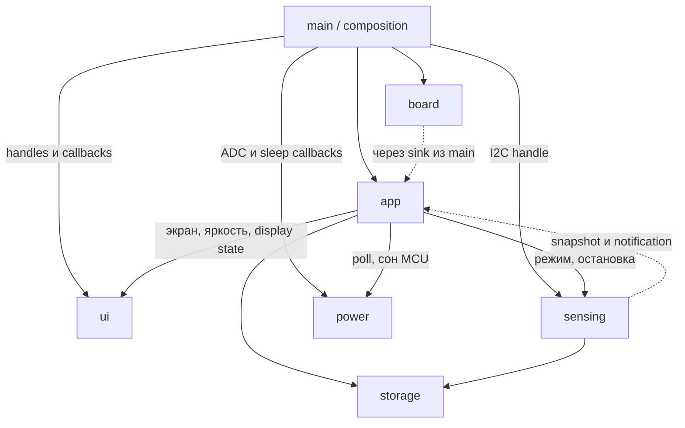

# Архитектура Nimbus v2

Этот документ задаёт целевое поведение и контракты новой реализации с нуля.
Текущее состояние кода и результаты проверок — в
[verification-log.md](verification-log.md). Код v1 остаётся в истории `master`;
в v2 используются его готовые изображения и шрифты, но не исходники приложения.

## 1. Платформа и границы проекта

Одна прошивка C/C++ на ESP-IDF 5.5.3 под LILYGO T-Display, ESP32, flash 4 МБ.
UI — LVGL 8.4.0; обработка BME680 — Bosch BSEC2 2.6.1.0. Независимый загрузчик
приложений, интерпретатор и поддержка неизвестных плат не входят в проект.

Внешний вид и пользовательские экраны сохраняются. Основные измерения: static IAQ,
температура и влажность. Давление в Па и сопротивление газа в Ом доступны только
в диагностическом логе; отдельного пользовательского экрана для них нет.

| Узел | Подключение |
| --- | --- |
| ST7789 135×240 | MOSI19, SCLK18, CS5, DC16, RST23, подсветка4 |
| MISO дисплея | `-1`, GPIO21 занят I2C |
| PREV / NEXT | GPIO0 / GPIO35, активный LOW; GPIO35 требует внешней подтяжки |
| BME680 | SDA21, SCL22, 3,3 В, адрес 0x76 или 0x77 |
| Батарейный ADC | GPIO34 / ADC1 channel6, ADC_EN14; поведение проверить на плате |
| Аккумулятор | 103030, 1150 мА·ч, 3,7 В, штатный разъём под экраном |

Назначения GPIO сохраняются. Основные электрические неизвестные перечислены
в [протоколе этапа 1](hardware-bringup.md).

## 2. Владельцы состояния и зависимостей

| Компонент | Владеет | Публичный контракт |
| --- | --- | --- |
| `main` | Создание, соединение и время жизни инфраструктуры | Composition root |
| `board` | Аппаратные ресурсы и их низкоуровневые операции | Handles, callbacks и результаты инициализации |
| `app` | Состояние устройства, экран, предпочтение яркости, политики и сроки | События и функции переходов с явным временем |
| `ui` | Все объекты LVGL, дисплей, его сон, фактическая подсветка и display PM lock | `ui_apply_model()`, `ui_set_display_state()` |
| `sensing` | BME680/BSEC, фаза датчика, расписание, восстановление и state blob | Запросы режима/остановки, последний snapshot |
| `power` | Оценка батареи и выполнение команды сна MCU | Синхронный `power_poll()`, подготовка и вход в сон |
| `storage` | Формат и сохранение настроек / blob | Чтение и запись с результатом ошибки |

Только `main` зависит от компонента `board`. `board_init()` возвращает ресурсы
с отдельными статусами готовности; `composition.c` передаёт их потребителям:

- `sensing`: заимствованный `i2c_master_bus_handle_t`; сервис сам пробует адреса
  и владеет созданным device handle. Владельцем самой шины остаётся `main`.
- `ui`: panel и panel-IO handles, callback изменения PWM с контекстом.
- `power`: `read_battery_fn(ctx, out)` и callbacks подготовки/входа в сон.
  ADC unit/cali handles принадлежат аппаратному адаптеру и не попадают в модель.
- обработчик кнопок получает sink событий, связывающий его с `app`.

Callbacks используют типы контрактов потребителя; сигнатуры из `board.h` не
утекают в `sensing`, `ui` и `power`. Платформенные конфигурации с IDF handles
отделены от обычных C-заголовков моделей и политик.



Нижние слои не включают заголовки `app`. Настройки яркости хранятся в `storage`,
но актуальное предпочтение находится в `app`; только `ui` исполняет изменение PWM.
`power` не вызывает дисплей, LVGL или подсветку.

## 3. Структура проекта

Это границы компонентов, а не обещание конкретных будущих `.c` файлов:

```text
nimbus/
├── main/                         # app_main, composition, manifest
├── components/
│   ├── app/        include/{app.h, app_events.h, app_state.h}
│   ├── board/      include/board.h
│   ├── sensing/    include/sensing.h
│   ├── power/      include/power.h
│   ├── storage/    include/storage.h
│   └── ui/         include/{ui.h, ui_model.h}
├── assets/                       # готовые .bin и .fnt
├── artwork/                      # оригиналы после импорта
├── docs/
├── local-deps/                   # локальный BSEC, вне Git
├── dependencies.lock
├── sdkconfig.defaults
└── partitions.csv
```

Директории создаются вместе с реализацией. Используются новые API IDF:
`driver/i2c_master.h`, `esp_adc/adc_oneshot.h`, `adc_cali`, `esp_lcd`.
Legacy I2C driver и legacy ADC API не используются.

## 4. Контракт UI и сквозные сценарии

Один API владеет всеми переходами дисплея:
`ui_set_display_state(ui, ON | DIM | OFF, effective_brightness_pct)`.
`app` вычисляет режим и эффективную яркость; UI возвращает результат, а не
объявляет неудавшийся переход успешным. Повтор одинакового запроса идемпотентен.
Сохранённая пользовательская яркость при DIM/OFF не меняется.

**OFF:** запретить новые render/flush, остановить LVGL tick/timers под его lock,
дождаться завершения уже запущенного SPI DMA с таймаутом, погасить PWM, выполнить
display-off и `esp_lcd_panel_disp_sleep(panel, true)`. Только после подтверждения
сна панели и отсутствия DMA освободить `ESP_PM_NO_LIGHT_SLEEP`.
Ожидание DMA не удерживает mutex, требуемый обработчику его завершения.

**ON/DIM из OFF:** сначала взять PM lock, вывести панель из сна с задержками
драйвера, восстановить LVGL, отрисовать актуальную модель, дождаться первого flush
и применить яркость. До первого кадра подсветка остаётся нулевой.
При ошибке остаётся безопасное тёмное состояние и возвращается ошибка в `app`.
Если незавершённый DMA не позволяет заснуть, PM lock сохраняется до восстановления.

В LVGL8 / esp_lvgl_port 2.7.0 `lvgl_port_stop()` отключает tick и timers, но его
задача продолжает цикл с `vTaskDelay`; это не полная остановка задачи.
Для OFF требуется небольшая адаптация закреплённого порта: ожидание уведомления
resume без периодического таймаута, с подтверждением quiesce. Адаптация включается
в этап 2; произвольный `vTaskSuspend` задачи, держащей LVGL mutex, запрещён.
До неё нельзя объявлять режим OFF свободным от пробуждений UI.

`app_task` вызывает `ui_apply_model()` синхронно: внутри берётся ограниченный
по времени `lvgl_port_lock`, изменяются только отличающиеся поля, затем unlock.
При OFF можно обновить объекты/последнюю модель, но запускать отрисовку нельзя.
При timeout приложение оставляет модель dirty и повторяет передачу по явному
сроку. Отдельного буфера доставки с таймером опроса нет. LVGL render task остаётся
владельцем flush; app не получает `lv_obj_t*`. Timer callbacks lock повторно не берут.

Штатное выключение координирует `app`: закрыть приём новых пользовательских команд,
показать состояние выключения, запросить остановку `sensing`, дождаться ACK
с request ID и таймаутом 3 с, сохранить настройки, вызвать UI OFF, дождаться
отпускания кнопок и передать команду deep-sleep в `power`. При просроченном ACK
обычное выключение отменяется с диагностикой; вызов BSEC/deinit из `app` всё равно
запрещён. При подтверждённом критическом разряде допустим принудительный сон после
ограниченного срока, с потерей несохранённого checkpoint, без вызовов BSEC из чужой
задачи. Незавершённый UI OFF не объявляется успешным переходом. Вход в deep-sleep
не возвращается; timeout не превращается в бесконечное ожидание или reboot loop.

## 5. Задачи, доставка данных и watchdog

- `app_task` — единственный изменяющий `app_state`. Ждёт task notification либо
  ближайший срок батареи, простоя, свежести или повтора команды.
- `sensing_task` — единственный владелец BME680/BSEC, ждёт `next_call` или команду.
- LVGL task обслуживает render только при разрешённом дисплее.
- `power` — синхронная библиотека без своей задачи. `app` вызывает `power_poll()`
  по собственному сроку; callback ADC ограничен по времени.

Для телеметрии используются последние snapshot с generation/timestamp под mutex.
`sensing` записывает snapshot, отпускает mutex и будит `app` битом `xTaskNotify`.
Несколько обновлений объединяются. Результат синхронного `power_poll()` обрабатывается
в текущей итерации app без бессмысленного уведомления самого себя.

В очередь идут пользовательские команды. После enqueue выставляется control-bit,
поэтому `app` ожидает одну notification, а не блокируется только на очереди.
ACK остановки имеет отдельный слот с request ID и бит; заполненная очередь ввода
его не блокирует. Ожидание читает/очищает биты атомарно; mutex телеметрии никогда
не удерживается при вызовах UI, BSEC или storage.

Начальная ёмкость очереди — 16 команд. Слоты не гарантируют бесконечную вместимость
команд: при отказе enqueue выставляется sticky overflow flag, выполняется явная
диагностика и отмена неоднозначного подтверждения. Ошибка не скрывается.

Task WDT: 10 с, timeout вызывает panic и coredump. Задачи `app` и `sensing`
подписываются на время активной работы, сбрасывают WDT в контрольных точках и
снимают подписку перед штатным длительным ожиданием. После пробуждения подписка
восстанавливается до работы. Блокирующие аппаратные операции имеют меньшие таймауты.
ULP-ожидание 300 с не сопровождается пробуждениями лишь ради watchdog. IDLE checks
сохраняются; потерянное измерение дополнительно выявляет deadline свежести в app.

## 6. Состояния приложения и навигация

`app_state` содержит режим (`STARTING`, `ACTIVE`, `MONITORING`, `SHUTTING_DOWN`,
`FAULT`), выбранный экран, параметры диалога, настройки, последние snapshot,
их достоверность и сроки. Enum фазы датчика принадлежит `sensing`; app копирует его.
Прогрев датчика и сон дисплея — независимые состояния.

Дребезг: 50 мс; long press: 1500 мс, один раз за удержание. Short формируется
только после отпускания, если long не был выдан. Wake-нажатие полностью потребляется
до отпускания и не вызывает навигацию/выключение.

Основной цикл: `IAQ → TEMP → HUM → IAQ`; PREV идёт в обратную сторону.
Яркость 5–100%, шаг 5%, начальное значение при отсутствии настройки — 60%.

| Экран / режим | Short PREV | Short NEXT | Long PREV | Long NEXT |
| --- | --- | --- | --- | --- |
| STARTING | Игнорировать | Игнорировать | Игнорировать | Игнорировать |
| IAQ | HUM | TEMP | Открыть выключение, выбран Yes | Открыть яркость |
| TEMP | IAQ | HUM | Открыть выключение, выбран Yes | Открыть яркость |
| HUM | TEMP | IAQ | Открыть выключение, выбран Yes | Открыть яркость |
| BRIGHTNESS | −5%, с ограничением | +5%, с ограничением | Игнорировать | Сохранить и вернуться |
| SHUTDOWN QUESTION | Если Yes выбран — подтвердить; иначе выбрать Yes | Если No выбран — отменить; иначе выбрать No | Игнорировать | Игнорировать |
| MONITORING | Разбудить, потребить нажатие | Разбудить, потребить нажатие | То же wake-нажатие, без long-команды | То же |
| SHUTTING_DOWN | Игнорировать | Игнорировать | Игнорировать | Игнорировать |

Это сохраняет управление v1, включая исходный выбор Yes; отпускание открывшего
диалог long press не подтверждает выключение. Отмена/выход возвращает прежний
основной экран. После 30 с бездействия — DIM, после 60 с — OFF/MONITORING.
При уходе в мониторинг незавершённый диалог отменяется, яркость сохраняется;
wake возвращает основной экран. Действие из DIM одновременно восстанавливает ON
и выполняется. После мониторинга первое нажатие только будит экран.

Событие подтверждённой зарядки показывает уведомление на 3 с без изменения
навигации. Оно не перекрывает диалог выключения; пока зарядка UNKNOWN, анимации
и экрана «Заряжено» нет. Приоритет критической ошибки выше уведомления зарядки.

## 7. Измерения и BSEC

Контракты фаз, условия показа IAQ, config blobs, политика сохранения и подключения
библиотеки определены в [bsec.md](bsec.md). IAQ и static IAQ хранятся отдельно;
показать 0 вместо недостоверного результата запрещено. Температура и влажность
имеют собственные validity/timestamp и могут быть доступны во время прогрева IAQ.

Свежесть определяется фактическим новым результатом, а не возвратом кэша.
Начальные пороги stale: LP 10 с, ULP 660 с от последнего нового значения.
После запроса смены режима порог не расширяется до подтверждения sensing.
Ошибка чтения отмечает проблему, последнее число сохраняется только с признаком
устаревания. Давление в BSEC передаётся в Па.

Ошибки первичной/повторной инициализации запускают retry с backoff 1, 2, 5, 10,
затем 30 с. Контроль ввода/батареи продолжает работать. Неудача reinit не делает
сервис навсегда неактивным. Точное расписание измерений принадлежит `next_call` BSEC.

## 8. Питание и процент батареи

Источник, зарядка, наличие батареи и достоверность SOC — независимые поля.
Основной сценарий на штатной плате: источник UNKNOWN или предполагаемое USB,
зарядка UNKNOWN; доступность CHRG на GPIO не предполагается.
Переход к подтверждённым состояниям разрешён только по аппаратному измерению
или проверенному сигналу, а не по росту напряжения и выдержке времени.

| Достоверные данные | UI |
| --- | --- |
| Работа от батареи, SOC доступен | Значок батареи и процент |
| Зарядка подтверждена, SOC доступен | Индикатор зарядки и процент |
| Зарядка подтверждена, SOC неизвестен | Индикатор и `--%` |
| Подтверждено только внешнее питание | Значок питания; без утверждения о зарядке |
| Только предполагаемое USB | Нейтральное состояние питания, без анимации зарядки |
| Завершение зарядки подтверждено | «Заряжено» |

ADC_EN включается только для замера, выключается в том числе после ошибки ADC.
Оценка: калиброванный ADC → серия отсчётов → фильтр → профиль конкретной батареи
→ SOC; сглаживание UI — отдельный последний шаг. Недостоверный ADC не равен 0%.
Критический разряд определяется напряжением с подтверждением и гистерезисом.
Пороги и поведение при USB выбираются после начальных измерений этапа 1;
фиксированная компенсация «−100 мВ при зарядке» не считается универсальным решением.

Батарея опрашивается раз в 2 с при активном экране, раз в 60 с в мониторинге;
при подтверждённом приближении к порогу — чаще. Это исходные сроки для измерения,
а не подтверждённая защита. Интервал и пороги пересматриваются по результатам.

## 9. Light-sleep и deep-sleep

LEDC использует APB; при ON и DIM UI удерживает `ESP_PM_NO_LIGHT_SLEEP`.
DFS допустим с корректным тактированием PWM/SPI. Light-sleep разрешается только
после полного UI OFF. Работа LEDC от RC_FAST во сне не входит в базовый вариант.
Wi-Fi/Bluetooth не запускаются. Базовое измерение — LP, ULP добавляется на этапе 5.

| Режим | Пробуждение / удержание |
| --- | --- |
| Light-sleep, экран OFF | GPIO0 и GPIO35: `GPIO_INTR_LOW_LEVEL` через `gpio_wakeup_enable` и `esp_sleep_enable_gpio_wakeup` |
| Нажатая кнопка | Level wake временно снимается для неё; сон запрещён до подтверждённого отпускания, затем wake вооружается снова |
| Deep-sleep PREV | `esp_sleep_enable_ext0_wakeup(GPIO_NUM_0, 0)` |
| Deep-sleep NEXT | `esp_sleep_enable_ext1_wakeup_io(1ULL << GPIO_NUM_35, ESP_EXT1_WAKEUP_ALL_LOW)` |

EXT0 и EXT1 совместимы на целевом ESP32; маска EXT1 содержит только GPIO35.
`ALL_LOW` с двумя активными LOW-кнопками потребовал бы одновременного нажатия.
EXT0 оставляет RTC_PERIPH включённым, что учитывается в токе deep-sleep.
ULP как режим BSEC не означает использование ULP-сопроцессора ESP32.

Перед deep-sleep обе кнопки должны быть отпущены стабильно 50 мс; ожидание
ограничено 3 с. При застрявшей кнопке сон откладывается с диагностикой, без
программного сброса. GPIO0 — strapping pin: запрещён автоматический restart,
пока PREV удерживается; внешний reset/power-on с ним может выбрать download mode.
После wake нажатие подавляется до отпускания, RTC pins возвращаются в GPIO.

Перед сном панель получает SLPIN, LEDC останавливается, GPIO4 и GPIO14 фиксируются
в LOW. Базовый вариант для этих RTC-capable выводов — RTC output + `rtc_gpio_hold_en`.
После wake сначала задаются известные безопасные уровни, затем корректно снимается
hold и возвращается цифровая функция; проверяется отсутствие вспышки подсветки.
Для цифрового варианта недостаточно одного `gpio_hold_en`: нужен также
`gpio_deep_sleep_hold_en`. Глобальный force-hold всех пинов не используется.
Настройки подтяжек кнопок, SPI и I2C проверяются по схеме и реальному току.

Измерение тока сна всей платы с удержанием GPIO и проверка wake выполняются
до оптимизаций. Расчёт 1150 мА·ч / средний ток — оценка; питание USB и ток только
ESP32 не подменяют измерение тока аккумулятора.

## 10. Память, ресурсы и хранение

Базовый вариант остаётся SPIFFS `/spiffs` и runtime `.fnt`; см.
[assets.md](assets.md). Замена на LittleFS или EMBED_FILES — отдельное решение
по измерениям этапа 2. LittleFS потребует явной зависимости и своей конфигурации;
просто сменить subtype раздела недостаточно.

Пять `.fnt` занимают около 80 КиБ файлов, а `lv_font_load` размещает данные в heap;
фактическое выделение измеряется отдельно. Фиксируются free/minimum/largest block
внутренней и DMA-памяти до/после загрузки шрифтов, draw buffers и создания экранов.
Проверяется многократная навигация. Кэш всех изображений в RAM не предполагается.

Встраивание `.bin` может исключить файловые чтения изображений и хранить пиксели
во flash. Оно не является автоматически zero-copy для SPI DMA: проверяются
формат/выравнивание LVGL8, заголовок, swapped RGB565 и требования DMA к буферу.
Числа ширины/высоты не извлекаются предположением о произвольном 4-байтовом файле.

Настройки версионируются и проверяются по диапазонам. Яркость сохраняется через
2 с после последнего изменения, при выходе из настройки и штатном выключении;
не на каждое нажатие. Ошибка ключа не стирает весь NVS. SPIFFS автоматически
не форматируется. Память и ожидания имеют явные границы.

## 11. Загрузка, отказы и диагностика

| Отказ | Поведение |
| --- | --- |
| Экран / panel / LVGL | UI недоступен, подсветка LOW; `FAULT`, UART-диагностика и доступный контроль батареи, без restart loop |
| I2C bus | Только sensing недоступен; retry аппаратного адаптера по запросу main, затем новый handle передаётся после остановки sensing |
| BME680/BSEC | ERROR/retry в sensing; UI, кнопки и батарея работают |
| ADC/cali | Питание UNKNOWN, SOC скрыт; ошибка не считается разрядом |
| Отдельные настройки NVS | Значения по умолчанию и диагностика, без erase |
| Файловые ресурсы | Доступный встроенный текст/простые фигуры и сообщение об ошибке, без format |
| Не созданы app/task/основная очередь | Безопасная остановка через main: тёмный дисплей, UART, без заявления об успешном старте |

Графический UI обязателен для нормального ACTIVE. В headless FAULT команды,
требующие видимого подтверждения, не исполняются вслепую. Ошибка UI не должна
оставить активный PWM или запретить измерение достоверного критического разряда.
Удаление шины/handles допустимо только после ACK использующих их компонентов.

`coredump` занимает 64 КиБ после storage. Включены flash, ELF, CRC32, отдельный
стек 2048 байт, до 8 задач; полный DRAM capture выключен. Размер проверяется
по реальным TCB/стекам и ELF overhead после создания задач. Наличие раздела
не гарантирует сохранение любого fault: brownout/полная потеря питания могут
не оставить дамп. Эталонный ELF и map сохраняются для каждого аппаратного запуска.

Чтение: `idf.py -p COM3 coredump-info` или `coredump-debug` с соответствующим ELF.
Контролируемая паника и чтение дампа входят в аппаратную диагностику этапа 1;
в продуктовой точке входа намеренного panic нет.

## 12. Проверки и этапы

Переходы, навигация, расчёт батареи и политики не включают ESP-IDF, FreeRTOS
или LVGL. `ui_model.h` не включает `lvgl.h`. Аппаратные сценарии выполняются
на устройстве с регистрацией реальных результатов.

1. **Board:** сначала ADC при USB с батареей / без неё и ток deep-sleep с pin hold;
   затем экран, ввод, I2C, оба wake и coredump. Протокол —
   [hardware-bringup.md](hardware-bringup.md). Результаты определяют разделы 8–9.
2. **App/UI:** таблица навигации, демонстрационная модель, display state machine,
   адаптация ожидания LVGL8 OFF, расход heap и отсутствие утечек.
3. **Sensing:** LP и проверенный blob, фазы/валидность, retry, state persistence.
4. **Power/settings:** модель батареи на измеренных данных, сохранение яркости,
   завершение сервисов, сон и wake.
5. **ULP:** подходящий blob и отдельная проверка state compatibility и переключения;
   измерение среднего тока и задержки реакции перед включением профиля.

Готовность функции: сборка без новых предупреждений, boot без aborts/asserts,
изменённый путь выполнен на плате. Логи и результаты идут в verification-log,
а не в архитектуру. Неизмеренные значения остаются неизвестными.

## Источники

- [ESP-IDF 5.5.3: sleep modes](https://docs.espressif.com/projects/esp-idf/en/v5.5.3/esp32/api-reference/system/sleep_modes.html).
- [GPIO / hold](https://docs.espressif.com/projects/esp-idf/en/v5.5.3/esp32/api-reference/peripherals/gpio.html).
- [Core dump](https://docs.espressif.com/projects/esp-idf/en/v5.5.3/esp32/api-guides/core_dump.html).
- [esp_lvgl_port: LVGL8 implementation](https://github.com/espressif/esp-bsp/blob/master/components/esp_lvgl_port/src/lvgl8/esp_lvgl_port.c).
- Точные локальные Kconfig/headers и реализация SDK 5.5.3 проверяются вместе
  с закреплёнными зависимостями, а не по API другой модели ESP32.
